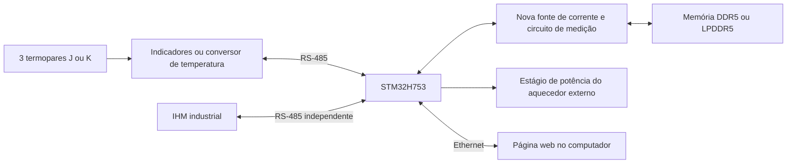

# Anotação para a equipe - arquitetura e estratégias do MVP

Data: 26/10/2026. Estado: proposta de arquitetura, ainda sujeita às definições de hardware. Não descreve uma implementação concluída.

## Objetivo

Transformar a POC em um equipamento com operação local pela IHM e acompanhamento pelo navegador. O STM32 mantém a responsabilidade pela medição, controle e tratamento de falhas.

## Arquitetura proposta

| Parte | Responsabilidade |
|---|---|
| STM32H753 | Coordenar calibração, aquecimento, aquisição, ensaio TSP e falhas. |
| Três termopares | Acompanhar temperaturas nos pontos definidos da montagem. |
| IHM Delta DOP-107BV | Configurar parâmetros, iniciar/parar procedimentos e mostrar estados e alarmes. |
| Fonte e circuito de medição | Alimentar o DUT e medir os sinais elétricos necessários à caracterização. |
| Aquecedor externo | Produzir os patamares de temperatura para a calibração, por estágio de potência apropriado. |
| Página web | Apresentar gráficos, resultados e exportação de relatórios, seguindo a ideia do Thermal Analyzer. Histórico persistente depende da solução de armazenamento. |

## Estratégias

1. **Medição independente das telas e da rede.** Temporização do TSP local, com timer e ADC/DMA. Atualização da IHM e latência Ethernet não determinam o instante da medição.
2. **Comunicação eficiente.** DMA e interrupções curtas na comunicação serial. Processamento fora das interrupções, timeout e horário/validade por canal. Consultas seriais não garantem amostragem simultânea dos termopares.
3. **Uma única lógica de operação.** IHM e página web enviam comandos à mesma máquina de estados. O STM32 arbitra os comandos e recusa operações incompatíveis com a sessão atual.
4. **Blocos simples e separados.** Adaptação da placa, drivers, lógica dos ensaios e interfaces seguem a organização da POC. Interfaces claras reduzem o impacto da troca de componentes.
5. **Dados rastreáveis.** Registrar parâmetros, calibração, sinais medidos, tempos reais e falhas. A Ethernet substitui o cartão como transporte, mas não garante armazenamento após desligamento.
6. **Otimização medida.** Conferir tempo de captura, latência, RAM e CPU. Definir memória acessível a DMA e coerência de cache antes de integrar os periféricos do H753.

## Definições já informadas

- Placa NUCLEO-H753ZI.
- IHM Delta DOP-107BV, ligada por serial; Ethernet fica entre STM32 e computador.
- N1040i RA-485-24V e suporte configurável a termopares J/K.
- Três termopares.
- Transceptor RS-485 MAX485; conferir níveis elétricos com o H753.
- DUTs DDR5 e LPDDR5.
- Fonte com correntes fixas ajustadas no circuito, sem telemetria de corrente e sem ajuste por firmware. Confirmar os valores numéricos para os DUTs.
- Firmware sem RTOS, com superloop cooperativo, máquinas de estado, DMA e interrupções curtas.
- Prazo informado pela equipe: quatro meses.
- Calibração com aquecedor externo comandado pelo STM32.

## Pendências

| Ponto | Decisão necessária |
|---|---|
| Três canais | Cada N1040i possui uma entrada; definir quantidade de indicadores ou conversor multicanal. |
| Memórias | Receber datasheets para confirmar sinal termossensível acessível, alimentação e forma de aquecimento. |
| Fonte de corrente | Dimensionar valores fixos, tensão e proteção a partir dos DUTs; corrente será declarada nos resultados. |
| Aquecedor | Escolher tipo, potência, faixa e estágio de acionamento. |
| Termopares | Definir posição e grandeza física de cada canal. |
| Persistência | Definir preservação dos resultados após desligamento/perda da conexão. |

## Ordem de desenvolvimento

1. Fechar requisitos elétricos e interfaces.
2. Validar H753, três temperaturas, IHM e Ethernet.
3. Implementar e verificar aquisição elétrica.
4. Implementar calibração com aquecedor externo.
5. Implementar ensaio TSP.
6. Integrar página web, gráficos e relatórios.

## Versionamento

A POC fica preservada na release `v1.0.0-poc` e na branch `poc-stm32f407`. O desenvolvimento do MVP ocorre em `mvp-stm32h753`, sem alterar a tag da POC.

[Escopo técnico e estrutura de pastas](README.md)
