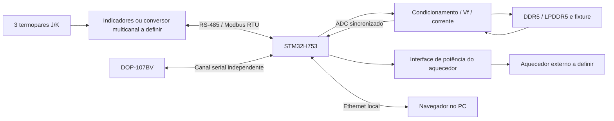

# MVP - arquitetura e escopo inicial

Estado: planejamento, 26/10/2026. Desenvolvimento separado da POC consolidada. Este documento não constitui firmware H753 pronto nem circuito dimensionado.

## Definições do responsável

| Item | Definição |
|---|---|
| Controle principal | NUCLEO-H753ZI. |
| Operação local | IHM Delta DOP-107BV. |
| Temperatura | Três termopares, com suporte configurável a J e K. |
| Indicador informado | N1040i RA-485-24V; confirmar a identificação final da etiqueta. |
| Interface física serial | Transceptor MAX485. |
| DUT | Memórias DDR5 e LPDDR5; componentes exatos e datasheets pendentes. |
| Corrente | Nova fonte; não herdar automaticamente os 758 mA/2 mA da POC. |
| Calibração elétrica | Aquecedor externo comandado pelo STM32. Aquecedor ainda em aberto. |
| Resultados | Ethernet direta ao PC; página web com análise, gráficos e relatório semelhantes ao Thermal Analyzer. |
| Aquisição/comunicação | DMA e interrupções onde apropriado, mantendo janela de Vf determinística. |

## Arquitetura proposta

Separar o plano de aquisição/segurança do plano de comunicação. A máquina de estados e os limites de potência pertencem ao STM32; nem o navegador nem a IHM devem ser responsáveis pela temporização da captura de Vf.

## Temperatura e RS-485

O manual N1040i v20x confirma configuração para termopares J/K, opção RS485 e funcionamento como escravo Modbus RTU. A variante RA oferece relé e retransmissão analógica de PV, não uma fonte de corrente do DUT. O N1040i é um indicador; não presumir que implementa o controle térmico do aquecedor.

Cada indicador tem uma entrada de sensor. Para três termopares, decidir entre três indicadores endereçados ou outra aquisição multicanal. Não conectar três termopares diretamente à mesma entrada nem presumir que três leituras Modbus são simultâneas.

Proposta de barramentos:

- UART A: STM32 mestre → indicadores/conversor escravos, endereços distintos.
- UART B: IHM mestre → STM32 escravo, condicionado à confirmação do driver Modbus RTU no DOPSoft.
- Transceptor e DE/RE por interface. Não unir dois mestres RTU ao mesmo par de fios.
- Definir terminação, polarização, referência comum, proteção e eventual isolamento no esquema.
- MAX485 clássico é alimentado em 5 V: conferir RO/DI e tolerância dos pinos escolhidos do H753; usar adaptação de nível ou alternativa compatível se necessário. Não conectar com base somente no nome TTL/CMOS.

A PV de temperatura no mapa do manual N1040i é um inteiro de 16 bits com sinal, no registro 0001, dividido por 10 para °C. Confirmar endereçamento de base zero no driver e tratar os códigos de falha. Registrar tipo de sonda, estado, instante e idade da amostra em cada canal.

## DMA e interrupções

- UART RX por DMA circular ou Receive-to-IDLE, com validação de tamanho/CRC e delimitação RTU por temporização. IDLE sozinho não garante um quadro Modbus completo.
- TX por DMA; desabilitar DE somente após Transmission Complete do UART, não apenas ao concluir a transferência DMA.
- Interrupções fazem trabalho curto: marcar eventos e mover índices. Parser, IHM e rede são processados fora da ISR.
- Uma consulta por vez no barramento de sensores; timeout e erro por canal. As taxas dos indicadores não substituem a aquisição rápida de Vf.
- Timer de hardware como referência para ADC/DMA e comutação no TSP, conforme viabilidade do timer/GPIO escolhidos. Registrar instantes observados, não somente o atraso solicitado.
- No H753, definir SRAM acessível a cada DMA, alinhamento e coerência de D-Cache/MPU. Não transportar automaticamente o linker F407 ou colocar buffers Ethernet em memória inacessível ao DMA.

## Aquisição elétrica e fonte de corrente

Antes de dimensionar a fonte, receber os part numbers e datasheets DDR5/LPDDR5. Confirmar se há diodo/junção acessível para termometria elétrica ou outro sinal termossensível adequado. Não inferir que um encapsulamento de memória pode ser polarizado como o diodo discreto da POC.

Definir correntes de medição/aquecimento, tensões por domínio, compliance, potência, fixture e limites absolutos. Verificar se aquecimento virá de corrente na junção acessível, da operação elétrica da memória ou de outro arranjo. A escolha altera a interpretação do TSP e o cálculo de potência.

Prever medição de corrente/tensão se a potência precisar ser medida em vez de somente declarada. Dimensionar front-end ADC, proteção, referência e acomodação antes de fixar resolução e taxa. Resolução nominal do ADC não garante exatidão de Vf.

## Calibração e controle do aquecedor

O STM32 comandará um estágio de potência apropriado ao aquecedor escolhido. Tensão, potência, atuador, faixa e necessidade de resfriamento ainda pendentes.

Definir função física de cada termopar antes de programar a malha: caixa do DUT, bloco/aquecedor ou referência/ambiente são sugestões a validar, não canais já confirmados. Interromper aquecimento por leitura inválida/vencida, timeout e limites definidos. Guardar configuração e histórico de calibração.

Para a calibração elétrica do DUT, estabelecer estabilidade/equilíbrio no patamar antes de relacionar a temperatura de referência ao sinal termossensível. O procedimento será revisto para o fixture das memórias; não copiar a captura imediata por alvo da POC como se ela garantisse equilíbrio.

## Ethernet e página web

Proposta: o STM32 serve os arquivos estáticos da interface e uma API local; o PC abre o endereço exibido na IHM. Sem serviço de nuvem e sem depender de CDN para recursos básicos. Endereçamento direto PC/placa, máscara e descoberta precisam de um procedimento de instalação.

O navegador executa gráficos e exportação; resultados brutos e metadados vêm do STM32. A implementação Python atual não roda automaticamente no navegador: os cálculos precisarão ser portados para JavaScript/TypeScript e comparados com fixtures do Analyzer, ou mantidos em um serviço no PC caso essa alternativa seja escolhida.

Recursos previstos: parâmetros e revisão de calibração/ensaio, estado em tempo real, três temperaturas com idade/validade, curva TSP, avisos, comparação de execuções, exportação de dados e relatório, identificação do DUT e versão/calibração utilizadas.

Captura não depende da latência TCP, da aba do navegador ou do desenho dos gráficos. Usar buffers locais com contagem/limite, número de sequência, sessão e indicação explícita de finalização. Definir ação de perda de conexão e arbitragem de comandos entre IHM e web; recusar comandos incompatíveis com a sessão atual.

Ethernet não fornece persistência por si só. Configurações/calibrações exigem armazenamento não volátil com versão e integridade. Resultados em RAM se perdem ao desligar; decidir retenção local e confirmação de recebimento/arquivo no PC. Não prometer histórico persistente até essa decisão.

## Organização de versões

- `main`: POC consolidada enquanto o MVP não tiver entrega aprovada.
- `poc-stm32f407` e tag `v1.0.0-poc`: referência/manutenção da POC.
- `mvp-stm32h753`: desenvolvimento independente; base herdada F407 continua como referência até a criação do projeto H753.
- `v2.0.0-mvp.0`: rascunho de planejamento, não release de firmware operacional.

Não portar a pinagem F407 diretamente. Reservar Ethernet, ST-LINK, UARTs, ADC e timer na revisão H753/MB1364 confirmada, depois conferir as funções alternativas e conflitos no CubeMX.

## Etapas e critérios de aceite

1. Fechar interfaces e fixture: modelos exatos das memórias, aquisição dos três termopares e requisitos da fonte.
2. Bring-up H753: boot seguro, clock, depuração, UART/DMA, Ethernet e mapa de memória/cache verificados.
3. Temperatura/IHM: três canais J/K, falhas/timeout, mapa de registradores e comandos únicos de sessão.
4. Aquisição Vf e corrente: calibração do front-end e medição da comutação/acomodação com instrumentação.
5. Calibração externa: aquecedor, estabilidade dos patamares e critérios de regressão/rastreabilidade.
6. TSP: captura rápida, buffer completo, falhas seguras e registros com tempos reais.
7. Web: API, gráficos, relatórios e equivalência numérica com dados de referência do Analyzer.
8. Integração: perda/reconexão da rede, múltiplos clientes, reset durante ensaio, sensor aberto e arquivos parciais.

## Referências consultadas

- Anexo NUCLEO-XXXXZX.PDF: seleção da família/placa; complementar com UM2407.
- ST UM2407: https://www.st.com/resource/en/user_manual/um2407-stm32h7-nucleo144-board-stmicroelectronics.pdf
- Exemplo oficial STM32CubeH7 LwIP HTTP: https://github.com/STMicroelectronics/STM32CubeH7/tree/master/Projects/STM32H743I-EVAL/Applications/LwIP/LwIP_HTTP_Server_Raw (referência de arquitetura/memória, não projeto pronto da NUCLEO-H753ZI).
- Anexo manual_n1040i_v20x_m_pt.pdf: entradas, identificação, RS485 e mapa Modbus.
- Anexo DOP-107BV_INSTRUCAO-DE-INSTALACAO.pdf: IHM 7 polegadas, 800×480, serial e alimentação 24 V; tabela informa ausência de interface de rede.

Datasheets comerciais completos dos termopares, memórias e nova fonte ainda pendentes. Nenhuma validação do MVP em hardware foi realizada nesta etapa.
