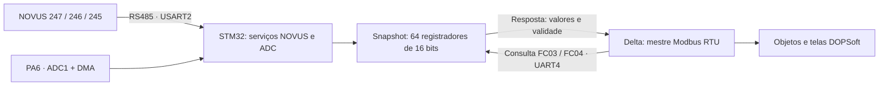

# DOPSoft · IHM da bancada CAIS

Ponto de entrada para quem vai desenvolver as telas da **Delta DOP-107BV (800 × 480)**. O STM32 já publica as informações em um **mapa de registradores Modbus RTU**; os objetos do DOPSoft consultam esse mapa.

**Firmware de referência:** `0.3.0-adc-dma`, mapa versão **2**. **Editor usado no projeto:** DOPSoft 4.00.16.

## Comece por aqui

1. Abrir [CAIS_MVP_Bancada.dpa](CAIS_MVP_Bancada.dpa) no DOPSoft e salvar uma cópia antes de editar.
2. Conferir o link de comunicação na tabela abaixo.
3. Criar um Numeric Display para **W40004**: os segundos devem avançar com o firmware em execução.
4. Adicionar os objetos de temperatura e validade indicados neste guia.
5. Usar o [mapa completo em CSV](../screens/bench/holding-registers.csv) para os demais dados.

O arquivo DPA foi preservado como recebido do trabalho local. Ele é um projeto em andamento: sua inclusão no Git não significa que todas as telas ou os novos objetos ADC já foram montados, compilados ou testados na IHM.

## Como o STM32 fornece as informações

O STM32 consulta os três NOVUS em um barramento próprio e mantém os valores e diagnósticos em memória. Quando a Delta pede um registrador, o serviço da IHM monta um snapshot desses dados, valida a consulta e responde. A Delta não precisa acessar diretamente os endereços 247/246/245: **ela consulta sempre a estação STM32 de endereço 1**.

O ADC publica tensão no pino PA6 com referência nominal; a validação elétrica ainda está pendente. Não é uma medição calibrada de Vf nesta etapa.

| Implementação no firmware | Responsabilidade |
|---|---|
| [hmi_uart.c](../../../fw/testbench/MVP_H753_Hardware_Bench/Application/hmi_uart.c) | UART4, recepção DMA circular, delimitação dos quadros e transmissão de resposta |
| [modbus_slave.c](../../../fw/testbench/MVP_H753_Hardware_Bench/Application/modbus_slave.c) | Endereço, CRC, limites, funções de leitura e exceções; rejeita escritas |
| [hmi_service.c](../../../fw/testbench/MVP_H753_Hardware_Bench/Application/hmi_service.c) | `hmi_register_snapshot()` define o conteúdo de cada posição; `hmi_step()` atende as consultas |
| [n1040.c](../../../fw/testbench/MVP_H753_Hardware_Bench/Application/n1040.c) | Atualiza temperaturas, status e validade dos três indicadores |
| [adc_service.c](../../../fw/testbench/MVP_H753_Hardware_Bench/Application/adc_service.c) | ADC por timer/DMA, estatísticas e diagnóstico da aquisição |
| [bench_config.h](../../../fw/testbench/MVP_H753_Hardware_Bench/Application/bench_config.h) | Parâmetros da bancada e comunicação |

Essa separação permite criar, reorganizar ou traduzir telas sem cadastrar telas no firmware. Para mostrar um **dado já publicado**, basta configurar o objeto no DOPSoft. Um dado novo ou um comando operacional novo exige ampliar primeiro o contrato do STM32.

## Configuração do link no DOPSoft

Em **General → Communication Settings**:

| Campo | Valor da bancada |
|---|---|
| Canal | COM1, Connection habilitado |
| Link Name | Link1 |
| Manufacturers / Series | Modbus / 984 RTU (Master) |
| Interface | RS485 |
| PLC Station | **1** |
| Baud Rate | **9600** |
| Data Bits / Parity / Stop Bits | **8 / None / 1** |
| Connection Timeout / Connect Retries | 1000 ms / 3, como ponto inicial |
| Comm. Delay Time | 5 ms, como ponto inicial |
| Optimize | Desmarcado inicialmente |

UART4 do STM32: **PD1 TX / PD0 RX**, módulo com direção automática. O barramento dos NOVUS continua independente, USART2 PD5/PD6 a 115200 baud. A indicação de COM1 refere-se à porta da Delta, não a uma COM USB do Windows.

Usar atualização visual inicial de aproximadamente 500 ms. O tempo de comunicação depende da quantidade de consultas; o atraso de 5 ms não é a atualização garantida de todas as telas. Não manter outro mestre Modbus no mesmo barramento durante a operação da Delta.

## O que significa “mapa de registradores”

É a tabela que associa cada endereço a uma informação, seu tipo e sua escala. Nesta bancada existem **64 palavras de 16 bits**, offsets de protocolo **0…63**.

Para o driver adotado:

**Endereço no DOPSoft = 40001 + offset Modbus.**

Assim, o offset 11 do firmware aparece como **W40012** no DOPSoft. Não enviar o número 40012 como offset binário do protocolo. Todos os valores ocupam uma palavra; não selecionar Float ou Double Word.

| Dado | DOPSoft | Formato / interpretação |
|---|---|---|
| Assinatura | W40001 | Hexadecimal: CA15 |
| Versão do mapa | W40002 | Unsigned: 2 |
| Versão do firmware | W40003 | Hexadecimal: 0300 |
| Heartbeat | W40004 | Unsigned, segundos; dá a volta após 65535 |
| Quantidade de NOVUS configurados / válidos | W40006 / W40007 | Unsigned |
| Temperatura NOVUS 247 | W40012 | Signed, uma casa decimal |
| Validade / online NOVUS 247 | W40013 / W40014 | Word, 0 ou 1 |
| Temperatura NOVUS 246 | W40022 | Signed, uma casa decimal |
| Validade / online NOVUS 246 | W40023 / W40024 | Word, 0 ou 1 |
| Temperatura NOVUS 245 | W40032 | Signed, uma casa decimal |
| Validade / online NOVUS 245 | W40033 / W40034 | Word, 0 ou 1 |
| Unidade dos canais 247 / 246 / 245 | W40020 / W40030 / W40040 | 0 = °C, 1 = °F |
| Link Ethernet | W40047 | Word, 0 ou 1 |
| ADC: dado recente/válido | W40048 | Word, 0 ou 1 |
| ADC: média / mínimo / máximo brutos | W40049 / W40050 / W40051 | Unsigned, 0…65535 |
| ADC: tensão em PA6 | W40052 | Unsigned, mV; ex.: 1000 = 1,000 V |
| ADC: amostras/s | W40053 | Unsigned, Hz |
| ADC: contador de blocos | W40054 | Unsigned, 16 bits inferiores |
| ADC: erro HAL / fase | W40055 / W40056 | Máscara de erro / inteiro; fase 7 = aquisição iniciada |
| ADC: referência nominal | W40057 | Unsigned, mV |
| ADC: blocos não processados | W40058 | Unsigned, 16 bits inferiores |

W40059…W40064 permanecem reservados. O [CSV](../screens/bench/holding-registers.csv) contém também os diagnósticos por canal, idades de leitura, timeouts e códigos de erro. Contadores publicados em 16 bits voltam a zero; isso não indica sozinho uma falha.

## Exemplo: mostrar a temperatura do primeiro NOVUS

1. Inserir **Elements → Data Display → Numeric Display**.
2. Em **Read Address → …**, selecionar **Link1**, **Device (Word)** e **Device Type W**.
3. Digitar somente **40012** no campo numérico Address/Value e confirmar com Enter. Usar estação 1.
4. Configurar **Word / Signed Decimal**, 4 dígitos inteiros e 1 fracionário; Gain 1 e Offset 0.
5. Criar um indicador de palavra para **W40013**: 0 = sem leitura válida; 1 = leitura válida.
6. Apresentar a unidade conforme **W40020**.

Exemplos: o inteiro **297** representa **29,7**; **−55** representa **−5,5**. A posição decimal faz a apresentação; não aplicar também um ganho de 0,1. O endereço pode aparecer no editor como `{Link1}1@W40012`, mas essa expressão não deve ser colada inteira no campo numérico.

Para os outros canais, repetir os objetos usando W40022/W40023/W40030 e W40032/W40033/W40040. Não definir a posição física “caixa/ambiente/bloco” sem confirmar onde cada termopar foi instalado.

## Exemplo: acrescentar uma tela de ADC

Criar uma tela local no DOPSoft e um botão de navegação para ela. Acrescentar objetos somente de leitura:

- W40048: indicador “dados ADC recentes”.
- W40049: média bruta, Word Unsigned Decimal, sem casas decimais.
- W40052: tensão em **mV**, inicialmente sem casas decimais para conferir a escala. Para apresentar V, usar a apresentação decimal equivalente a dividir por 1000 uma única vez.
- W40053: frequência configurada, Hz.
- W40055/W40056: erro e fase, para diagnóstico.

Não é necessário modificar o firmware para essa tela. O projeto DPA incluído não foi atualizado automaticamente para conter esses objetos. Uma entrada PA6 desconectada pode flutuar: `valid=1` indica aquisição recente sem falha, não confirmação de DUT conectado ou precisão elétrica.

## Validade e perda de comunicação

Temperatura e ADC devem aparecer como “—”/indisponíveis quando seu registrador de validade estiver em zero. Os indicadores 0/1 são **palavras**, não bobinas Modbus.

O estado online do NOVUS significa comunicação com o indicador; seu sensor ainda pode estar inválido. A perda do link Delta–STM32 pode deixar valores e indicadores antigos retidos na IHM: usar também o diagnóstico de comunicação do driver e o heartbeat W40004. Não usar apenas uma temperatura estável como prova de que o link está funcionando.

## Telas, idiomas e comandos

Navegação, imagens, textos, seleção local de idioma, brilho e som pertencem ao projeto da IHM e aos recursos do DOPSoft. As artes [React/TypeScript](../artwork/README.md) são referências visuais; não são executadas diretamente pela Delta. Exportar imagens e sobrepor objetos nativos de leitura no DOPSoft.

O contrato atual é **somente leitura**, com FC03/FC04. Não há registradores de iniciar ensaio/calibração, alterar IP, controlar corrente ou aquecedor, nem autenticação implementada no STM32. Uma tela de login local não cria autorização no firmware. Para futuras operações, combinar registradores, validação, resposta e tratamento de falhas antes de desenhar botões de escrita.

## Manutenção e entrega

- Versionar o DPA editável junto de alterações nas telas; registrar quais endereços foram usados.
- Manter [holding-registers.csv](../screens/bench/holding-registers.csv) e [guia completo](../protocol/GUIA_TELAS_DOPSOFT.md) alinhados com `hmi_register_snapshot()`.
- Ao acrescentar telas que usam dados existentes, manter link, estação, tipos e escalas.
- Compilar no DOPSoft e verificar os objetos alterados na IHM quando houver bancada disponível.
- A comunicação anterior da IHM e dos três NOVUS foi confirmada pelo usuário; a extensão ADC ainda aguarda teste físico.

Este commit organiza o projeto e documenta o contrato. Não modifica o conteúdo do DPA nem comprova sua compilação ou transferência para a Delta.
